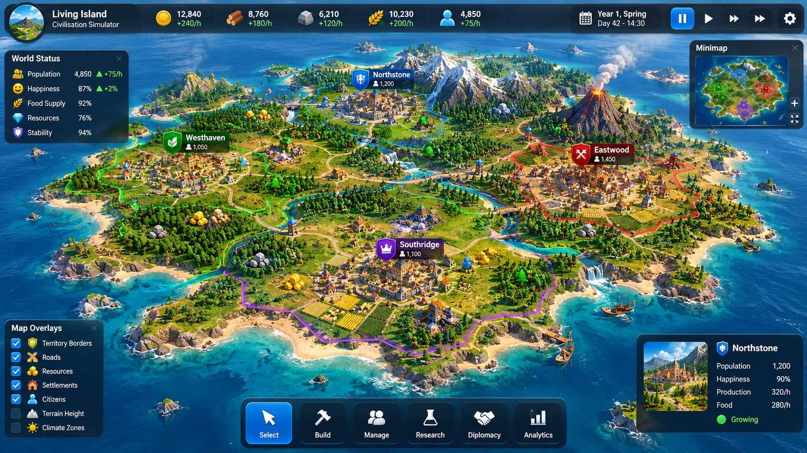

# Living Island: Civilisation Simulator

> **An autonomous, self-playing AI civilization simulation designed for 24/7 live streaming.**  
> Powered by Three.js, local neural models (Ollama, llama.cpp), and accelerated cloud inference (NVIDIA NIM).



---

## 🌟 Overview

**Living Island** is an autonomous sandbox simulation where four rival factions and thousands of simulated citizens make emergent decisions in real-time. Driven by a hierarchical AI brain, factions forge alliances, declare wars, harvest resources, build infrastructure, and trade across a vibrant 3D tropical island—all without human input.

An autonomous **Cinematic Director Camera** and **AI Voice Commentator** dynamically track high-stakes drama, battles, and milestones, broadcasting the simulation 24/7 to YouTube Live with interactive viewer chat participation.

---

## 🗺️ The World & Factions

The island is divided into four distinct territories, each marked by unique geography, architectural styles, and faction ideals:

| Faction | Territory Crest | Biome / Geography | Strategic Specialty |
| :--- | :--- | :--- | :--- |
| **Northstone** | 🛡️ Blue Shield | Snowy jagged northern peaks, stone quarries | Heavy fortifications, ironworks, defense |
| **Eastwood** | ⚔️ Red Crossed Swords | Eastern volcanic caldera, ash plains, basalt rocks | Weapons manufacturing, expansionism |
| **Westhaven** | 🍃 Green Leaf | Western rolling hills, pine and oak woodlands | Timber production, agriculture, trade |
| **Southridge** | 👑 Purple Crown | Southern fertile delta, coastal plains, ocean harbor | Naval commerce, shipping, cultural diplomacy |

---

## 🧠 Multi-Tier AI Architecture

To support real-time decision-making without inference bottlenecks, the simulation utilizes a **3-tier cognitive hierarchy**:

```
[ Tier 1: Faction Sovereigns ]  --> LLM (NVIDIA NIM / Ollama 14B): Diplomacy, wars, macro-economy
               │
[ Tier 2: Persona NPCs ]        --> Fast Local LLM (7B/8B): Mayors, captains, merchants, dialogue
               │
[ Tier 3: Living Populace ]     --> Utility AI & GOAP (0ms): Pathfinding, farming, mining, hunger
```

1. **Tier 1: Faction Sovereigns (Macro AI)**  
   High-level faction rulers query LLMs every few game cycles to negotiate treaties, levy taxes, commission grand buildings, or mobilize armies.
2. **Tier 2: Notable Personas (Meso AI)**  
   Village elders, merchant guildmasters, and military captains maintain episodic memory buffers, form interpersonal relationships, spread rumors, or stage rebellions.
3. **Tier 3: The Common Populace (Micro AI)**  
   Thousands of individual citizens and wildlife operate via deterministic Utility AI and Boids flocking, pathfinding along roads to gather food, chop wood, and haul ore.

---

## 📺 24/7 YouTube Live Streaming & Monetization

* **Cinematic Director Camera**: Smoothly rotates, zooms into hotspots, and executes dynamic crane shots whenever significant drama, combat, or construction occurs.
* **AI Neural Narrator**: Real-time sports/documentary style audio commentary powered by Kokoro TTS / Edge-TTS.
* **Interactive YouTube Chat**:
  * Viewers pledge loyalty to factions (`#TeamNorthstone`, `#TeamEastwood`).
  * Live commands (e.g., `!rain`, `!spawn bandit`, `!bless westhaven`).
  * Superchats and tips trigger dynamic events (volcanic eruptions, mercenary spawns, divine blessings).

---

## 🛠️ Tech Stack

* **3D Visual Engine**: [Three.js](https://threejs.org/) (r182) with WebGL, custom heightmap shaders, and soft shadows.
* **Procedural World**: Simplex Noise 2D for island topography, biomes, and vegetation distribution.
* **UI & HUD**: Pixel-accurate glassmorphism interface built with HTML5, CSS3, and Canvas.
* **Build Tooling**: [Vite](https://vitejs.dev/) with TypeScript for sub-second hot reloading.
* **AI Engine**: Python AsyncIO server interfacing with [Ollama](https://ollama.ai/), [llama.cpp](https://github.com/ggerganov/llama.cpp), and [NVIDIA NIM](https://build.nvidia.com/).
* **Broadcast**: Headless OBS Studio / FFmpeg RTMP pipe encoding 1080p60 directly to YouTube Live.

---

## 🚀 Getting Started

### Prerequisites
* [Node.js](https://nodejs.org/) (v20+ recommended)
* `npm` or `pnpm`

### Installation & Setup

1. **Clone the repository**:
   ```bash
   git clone https://github.com/your-username/living-islands.git
   cd "Living Islands"
   ```

2. **Install dependencies**:
   ```bash
   npm install
   ```

3. **Start the local development server**:
   ```bash
   npm run dev
   ```
   Open your browser to `http://localhost:3000` to interact with the 3D world and live HUD.

4. **Production Build**:
   ```bash
   npm run build
   npm run preview
   ```

---

## 🎮 Controls & Interface

* **Camera Controls**:
  * **Left-Click + Drag**: Orbit / rotate around the island.
  * **Mouse Wheel / Scroll**: Zoom in / zoom out.
  * **Idle Mode**: Automatic smooth cinematic glide across the island.
* **Interaction**:
  * **Click Settlements**: Inspect population, happiness, food, and production in the bottom-right Inspector Card.
  * **Map Overlays**: Toggle territory borders, roads, and citizen visibility via the bottom-left panel.
  * **Dock & Time Controls**: Select game modes and adjust simulation speed (1x, 2x, 3x, Pause).

---

## 📂 Project Structure

```
Living Islands/
├── assets/
│   └── world-map.png          # Reference game concept artwork
├── src/
│   ├── main.ts                # Three.js 3D world, terrain, settlements & game loop
│   └── style.css              # Strategy HUD glassmorphic styles & animations
├── index.html                 # Complete UI HUD structure (stockpiles, minimap, inspector)
├── package.json               # Dependencies & build scripts
├── tsconfig.json              # TypeScript compiler configuration
├── vite.config.ts             # Vite bundler configuration
└── README.md                  # Project documentation
```

---

## 📜 Architecture Documents & Roadmap

For comprehensive development plans and agent work assignments:
* [Master AI Simulation Game Plan](file:///C:/Users/onenine/.gemini/antigravity/brain/8cf3cc23-fc6e-476d-adae-fa226d008c84/ai_simulation_game_plan.md)
* [Visuals & UI Agent Development Plan](file:///C:/Users/onenine/.gemini/antigravity/brain/8cf3cc23-fc6e-476d-adae-fa226d008c84/visuals_and_ui_agent_plan.md)

---

## 📄 License
MIT License. Built for autonomous AI exploration and creative civilization simulations.

