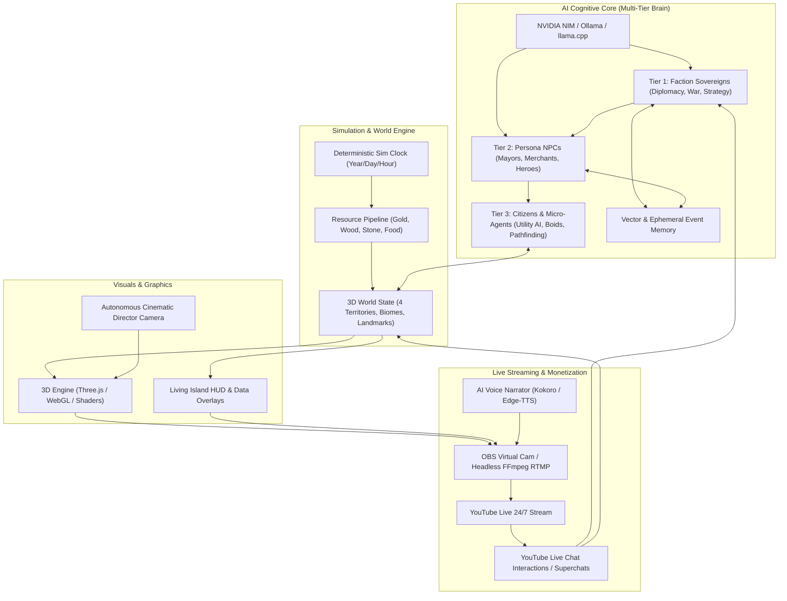
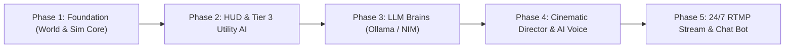

# Living Island: Autonomous AI Civilization Simulator
## Engineering & Multi-Agent Execution Blueprint

---

### Executive Vision
**Living Island** is an autonomous, self-playing civilization simulation where NPC factions and citizens make emergent decisions in real-time powered by local AI (Ollama, llama.cpp) and accelerated cloud APIs (NVIDIA NIM). The game runs continuously, rendering an isometric 3D living world, directed by an automated cinematic camera and AI commentator, and live-streamed 24/7 to YouTube with real-time viewer chat interactions.



---

## 1. System Architecture & Tech Stack

### 1.1 Technology Recommendation
To allow AI agents to generate, iterate, and debug code autonomously without heavy proprietary binary tooling, the optimal stack is:

* **Engine & Frontend**: **Three.js + TypeScript (Vite)**
  * *Why*: Completely agent-accessible code, fast hot-reloading, runs directly in any browser, zero build compilation friction, and directly streamable via OBS Browser Source or headless Puppeteer.
  * *Shaders & Visuals*: GLSL custom shaders for ocean water, low-poly terrain blending, and volcanic smoke/ash particles.
* **Simulation Core & AI Orchestrator**: **Python (FastAPI / AsyncIO) + WebSockets**
  * *Why*: Native integration with LLM inference stacks (Ollama, `llama-cpp-python`, NVIDIA NIM client), fast mathematical simulation for ticks, and async event queues.
* **Inference Layer**:
  * **Local**: Ollama or `llama.cpp` server running fast quantized models (e.g., `Qwen2.5-7B/14B`, `Llama-3.1-8B-Instruct`).
  * **Cloud Scaling**: NVIDIA NIM API (e.g., `meta/llama-3.1-70b-instruct` or `mistralai/mixtral-8x22b`) for complex high-stakes faction negotiations and narrator commentary.
* **Broadcast Pipeline**:
  * **Audio/Narration**: Local lightweight neural TTS (Kokoro-82M or Edge-TTS) for real-time dramatic sports/documentary style narration.
  * **Video Streaming**: OBS Studio (via OBS-WebSocket) or a direct `ffmpeg` RTMP pipe encoding to YouTube Live 1080p60.

---

## 2. Multi-Tier AI Cognitive Architecture

Running real-time LLM inference for thousands of citizens simultaneously is computationally impossible and causes latency bottlenecks. The solution is a **3-Tier Hierarchical Cognition Engine**:

```
[ Tier 1: Sovereigns ]  --> LLM (Every 10-30m or on major event): Faction macro-decisions
       |
[ Tier 2: Personas ]    --> Fast LLM / Slotted prompts: Key citizen dialogues, crimes, trade
       |
[ Tier 3: Populace ]    --> GOAP / Utility AI (0ms latency): Movement, farming, mining, hunger
```

### Tier 1: Faction Sovereigns (Macro AI)
* **Entities**: The rulers of **Northstone**, **Eastwood**, **Westhaven**, and **Southridge**.
* **Engine**: NVIDIA NIM or Local 14B LLM.
* **Decisions**: War declarations, alliances, trade embargoes, tax rates, architectural focus (e.g. "fortify the northern pass", "expand wheat farms").
* **Output**: Structured JSON schema parsed directly into the simulation state.

### Tier 2: Notable Citizens & Personas (Meso AI)
* **Entities**: Town mayors, guildmasters, merchant caravans, bandit captains, village elders (~20-50 active personas).
* **Engine**: Fast local 7B/8B LLM with batched inference.
* **Behaviors**: Personal rivalries, romance, rumors/gossip spreading, staging rebellions, requesting audience with faction leaders.
* **Memory**: Short-term buffer (recent events) + Long-term reflection summary.

### Tier 3: The Common Populace (Micro AI)
* **Entities**: The 4,850+ individual citizens, farmers, miners, guards, soldiers, and wildlife.
* **Engine**: Deterministic Utility AI & Goal-Oriented Action Planning (GOAP).
* **Parameters**: Needs curve (Hunger, Rest, Wealth, Safety, Morale).
* **Execution**: Flocking algorithms (Boids), A* grid pathfinding across roads and terrain, responsive to Tier 1 and 2 directives without burning GPU inference cycles.

---

## 3. World, Graphics & Asset Pipeline

### 3.1 Visual Styling & Biomes (Matching the Reference)
* **Terrain Generation**:
  * Hexagonal or stylized heightmap mesh with vertex coloring.
  * 4 Distinct Regional Biomes:
    1. **Northern Glaciers**: Snow-covered crags, stone quarries, ice rivers.
    2. **Eastern Caldera**: Volcanic black rock, lava flows, ash particles, fortified ironworks.
    3. **Western Woodlands**: Dense pine and deciduous forests, rolling green pastures, timber mills.
    4. **Southern Delta**: Sun-drenched coastal beaches, terraced wheat fields, docks, and trade ships.
* **Asset Library (Low-Poly / Stylized)**:
  * **Buildings**: Castles, keeps, town halls, farmhouses, windmills, lighthouses, watchtowers.
  * **Nature**: Trees (oak, pine, palm), boulders, crop fields (growing and harvested states), waterfalls.
  * **Units**: Low-poly rigged humanoid citizens with color-coded clothing matching faction borders (Blue, Red, Green, Purple).
  * **VFX**: Ocean foam, flowing river shaders, volcano smoke plumes, day/night dynamic sun cycle.

### 3.2 UI & HUD Replication
* Recreating the exact HUD from the reference:
  * Top Bar: Live resources (`Gold`, `Wood`, `Stone`, `Food`, `Pop`), game clock (`Year`, `Season`, `Day`, `Time`), and speed controls (`1x`, `2x`, `3x`, `Pause`).
  * Top-Left: **World Status** (Population, Happiness, Food Supply, Resources, Stability).
  * Top-Right: **Interactive Minimap** with territory bounds and camera frustum.
  * Bottom-Left: **Map Overlays** toggles (Borders, Roads, Resources, Citizens, Climate).
  * Bottom-Center: **Command Action Dock** (Select, Build, Manage, Research, Diplomacy, Analytics).
  * Bottom-Right: **Settlement Inspector Card** displaying population growth, happiness, and resource yield.

---

## 4. 24/7 Live Stream & Monetization Pipeline

### 4.1 Autonomous Cinematic Director Camera
The camera must never remain static or feel robotic:
* **Drama Detection Engine**: Evaluates high-tension events (e.g., a battle at the Eastwood border, a famine in Westhaven, a royal wedding in Southridge, an erupting volcano).
* **Cinematic Modes**:
  * *Establishing Crane Shot*: Slow rotation around the entire island.
  * *Street-Level Chase Cam*: Follows a specific merchant or citizen going about their daily routine.
  * *War/Raid Cam*: Low-angle tracking of skirmishes and territory conquests.
  * *Bird's Eye Strategy Cam*: Overhead view when major geopolitical agreements occur.

### 4.2 AI Live Narrator / Commentary
* An event listener logs high-priority milestones to an AI commentator prompt.
* TTS outputs a continuous voiceover in the persona of an eccentric island chronicler or sports caster:
  > *"Breaking news from Eastwood: Lord Julian has embargoed grain shipments to Northstone following last night's border dispute! As winter approaches, famine threatens the mountain citadel..."*

### 4.3 YouTube Chat Gamification & Viewer Revenue
* **Chat Integration (Polling / Webhook)**:
  * **Viewer Spawns**: Chat commands (e.g., `!spawn bandit`, `!bless westhaven`, `!rain`).
  * **Superchat / Tip Triggers**:
    * $5 Superchat: Triggers a localized natural disaster (e.g., volcanic eruption, thunderstorm).
    * $10 Superchat: Spawns a named Hero or Monster with custom stats and viewer name.
    * $20 Superchat: Subsidizes a faction's military campaign or builds a grand wonder.
  * **Faction Allegiance**: Viewers pick teams (`#TeamNorthstone`, `#TeamEastwood`) with chat participation shifting faction morale.

---

## 5. Agent Swarm Development Plan

Here is how specialized subagents will be assigned to construct the game modularly:

| Agent Role                    | Responsibilities                                                                                                                       | Key Deliverables                                                         |
| :---------------------------- | :------------------------------------------------------------------------------------------------------------------------------------- | :----------------------------------------------------------------------- |
| **Architect & Sim Agent**     | Core engine loop, game state, deterministic tick system, resource economy, data models.                                                | `engine/sim.py` or `src/sim/`, state manager, economy balance math.      |
| **3D Graphics & World Agent** | Three.js scene setup, terrain generation, biomes, low-poly procedural assets, lighting, and water/volcano shaders.                     | `src/world/`, procedural terrain, shaders, model loader.                 |
| **Cognitive Brain Agent**     | LLM prompt engineering, Ollama / llama.cpp / NIM API connectors, memory store, Tier 1/2 JSON decision parser, Tier 3 utility AI.       | `ai/llm_client.py`, `ai/agent_hierarchy.py`, memory vectors.             |
| **UI/HUD & Sound Agent**      | Recreating the reference interface (top bar, inspect cards, minimap, overlays, action dock) using HTML/Tailwind/CSS over WebGL canvas. | `src/ui/`, HUD components, overlay toggles, sound effects.               |
| **Director & Stream Agent**   | Camera drama scoring, cinematic spline camera controller, AI TTS narrator engine, YouTube chat scraper, and RTMP streaming scripts.    | `stream/director.py`, `stream/tts_narrator.py`, `stream/youtube_bot.py`. |

---

## 6. Development Phasing & Roadmap



1. **Phase 1: Visual Scaffold & Simulation Core**
   * Setup Three.js + Vite workspace.
   * Generate the island geometry: 4 zones, mountains, volcano, rivers, ocean.
   * Basic tick system running resource rates and population numbers.

2. **Phase 2: UI Replication & Living Populace**
   * Mount the exact HUD overlay from the screenshot.
   * Populate settlements with low-poly units using Utility AI (pathfinding between homes, farms, mines, and town centers).

3. **Phase 3: The LLM Sovereign Brain**
   * Connect Python FastAPI backend with Ollama/NIM.
   * Implement Faction Leaders reacting every few game cycles, generating real geopolitical shifts, alliances, and declarations.

4. **Phase 4: Autonomous Director & Narration**
   * Implement dynamic camera following points of interest.
   * Integrate Kokoro / Edge-TTS for dynamic vocal commentary of events.

5. **Phase 5: Broadcast Setup & Monetization**
   * Connect YouTube Live chat to the simulation events.
   * Configure headless rendering / OBS / FFmpeg pipe for 24/7 RTMP streaming.
